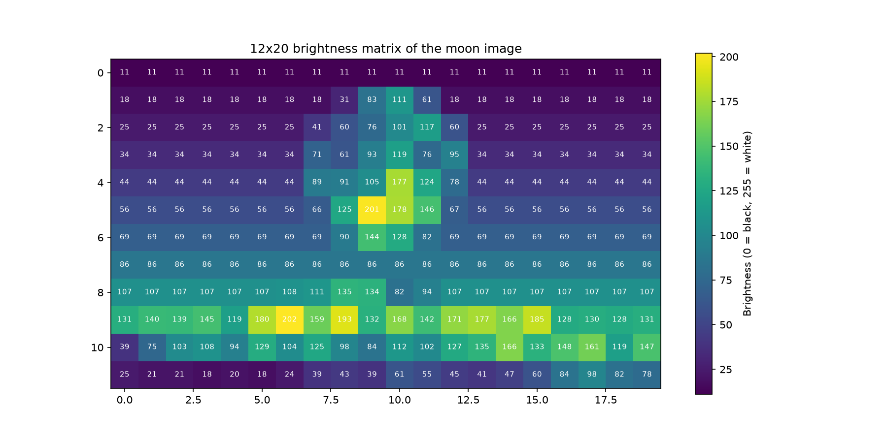

# Pixel Inspector: How a Computer Sees an Image

A Computer Vision assignment that loads a photo with OpenCV, shows that the computer stores it as a grid of numbers, and prints a specific spot of those numbers.

**Author:** Syed Ali Zain Naqvi ([@zainnaqvi-ai](https://github.com/zainnaqvi-ai))

## The idea

A computer does not see a moon or mountains. It sees a matrix of numbers.

- An image is a grid of **pixels**.
- In a **grayscale** image, each pixel is one number from `0` (black) to `255` (white).
- In a **color** image, each pixel is three numbers in **Blue, Green, Red** order. OpenCV uses BGR, not RGB.
- OpenCV loads an image as a NumPy array with shape `(rows, columns, channels)`.

## The image

`sample_image.jpeg` is a moon above a snowy mountain range.

| Property | Value |
|---|---|
| Size | 5120 × 2880 pixels |
| Total pixels | 14,745,600 |
| Color values (3 per pixel) | 44,236,800 |
| Data type | `uint8` (0 to 255) |

Image source: https://4kwallpapers.com/nature/moon-mountains-11462.html

## What the code does

**`analyze_image.py`**
1. Loads the image with OpenCV.
2. Prints the full color matrix (`[Blue Green Red]` per pixel) and the grayscale matrix.
3. Shrinks the image to **12 rows × 20 columns** and prints the whole matrix.
4. Prints a spot of the original: a 10×10 grayscale block, a 3×3 color block, and one pixel at row 953, column 2560 (Blue=147, Green=149, Red=157).
5. Saves the small matrix as `image_matrix_12x20.csv`.

**`create.py`**
Reads `image_matrix_12x20.csv` and draws it as a heatmap with each number shown in its cell, saved as `heatmap.png`.

## Why a 12×20 matrix?

Printing 14.7 million numbers is impractical, so Python and NumPy show only the start and end of the array (`...` in the output). The data is not lost. It is just not displayed.

To make the whole image visible at once, the image is shrunk to 12×20 (240 numbers). Each number is the average brightness of a block of about 240 × 256 pixels. Detail is lost, but the overall structure is clear:

- **Top rows (11 → 86):** dark sky that gets brighter going down.
- **Middle columns, rows 2 to 7 (up to 201):** the moon.
- **Lower rows (131 → 202, scattered):** the snowy mountain.



## Run it

Requires Python 3.13.

```bash
pip install opencv-python numpy matplotlib
python analyze_image.py
python create.py
```

Run `analyze_image.py` first, because it creates the CSV that `create.py` reads.

## Project files

| File | Purpose |
|---|---|
| `analyze_image.py` | Loads the image, prints matrices and a spot, saves the CSV |
| `create.py` | Builds the heatmap from the CSV |
| `sample_image.jpeg` | Input image |
| `image_matrix_12x20.csv` | The image shrunk to 12×20 brightness values |
| `heatmap.png` | Heatmap of that matrix |

## Notes

- The full-resolution matrix is not stored in this repository because of its size. It is generated in memory each time the script runs.
- The 12×20 matrix is a downscaled summary, not the full image data.

## Tech

Python 3.13 · OpenCV · NumPy · Matplotlib · PyCharm